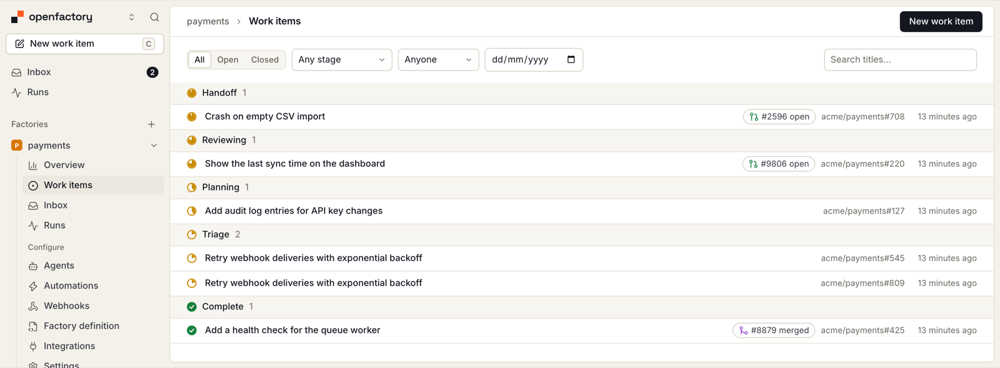
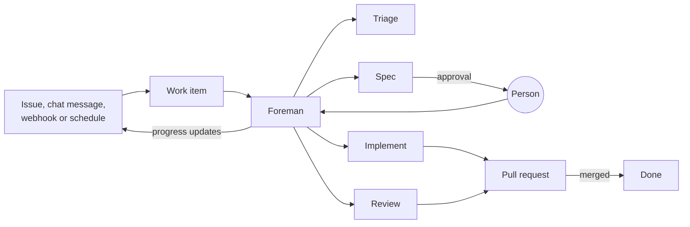

<div align="center">

<picture>
  <source media="(prefers-color-scheme: dark)" srcset="docs/assets/brand/logo-mark-dark.svg">
  
</picture>

# Open Factory

**Turn issues and chat requests into reviewed pull requests, on your own infrastructure.**

[](https://github.com/openfactory-org/openfactory/actions/workflows/ci.yml)
[](https://github.com/openfactory-org/openfactory/releases)
[](https://pkg.go.dev/github.com/openfactory-org/openfactory)
[](go.mod)
[](LICENSE)
<br>
[](https://github.com/openfactory-org/openfactory/stargazers)
[](https://github.com/openfactory-org/openfactory/issues)
[](https://github.com/openfactory-org/openfactory/labels/good%20first%20issue)
[](CONTRIBUTING.md)
[](https://github.com/openfactory-org/openfactory/discussions)

[Docs](docs/README.md) · [Quickstart](docs/quickstart.md) · [Examples](examples/) · [Contributing](CONTRIBUTING.md)

</div>

---

Your backlog has small, well-understood tasks that wait weeks for someone to pick them up. Open Factory gives your team AI coding agents that take those tasks from an issue, a chat thread or a schedule, do the work, and open a pull request for your engineers to review. It runs on your Kubernetes cluster, and people approve the decisions that matter.

<p align="center">
  <picture>
    <source media="(prefers-color-scheme: dark)" srcset="docs/assets/dashboard-dark.png">
    
  </picture>
</p>

## Why Open Factory

- **Work starts where your team already works.** Label an issue, mention the factory in Slack or Teams, or call a webhook.
- **Humans stay in control.** Agents stop and ask for approval or answers, in the dashboard inbox or in the original thread.
- **Everything is code.** Agents, automations and rules are files that you version and review like any other change.
- **Your infrastructure.** Each run gets its own sandbox in your cluster, with your secrets and your network rules.
- **Choose your agent.** Each agent runs on Claude Code or Codex, and one factory can mix both.
- **Measure the results.** Scorers grade runs, and benchmarks compare one configuration with another.

## How it works

1. **A request arrives.** An automation matches an event, such as a labeled issue, and creates a work item.
2. **A foreman coordinates the work.** It sends the work item through triage, spec, implementation and review agents, and asks a person when a decision is needed.
3. **You review a pull request.** The work item completes when the pull request merges.



Read more in [How factories work](docs/how-factories-work.md).

## Use cases

- [Issue triage](docs/use-cases/issue-triage.md): investigate new issues and recommend a category, priority and next step.
- [Issue implementation](docs/use-cases/issue-implementation.md): turn an approved issue into a reviewed pull request.
- [Code review](docs/use-cases/code-review.md): post review findings on pull requests, without changing code.
- [Incident resolution](docs/use-cases/incident-resolution.md): investigate a production failure and return an evidence report.
- [End-to-end SDLC](docs/use-cases/end-to-end-sdlc.md): carry an issue from triage to a pull request that a person merges.

## Quickstart

Run a development server on your workstation. You need Go, `git`, Claude Code (`claude` on your `PATH`), an Anthropic API key and a GitHub token.

```bash
git clone https://github.com/openfactory-org/openfactory.git
cd openfactory
make build
OF_DEV=true ./bin/openfactory serve
```

The server opens the dashboard at <http://localhost:8080> and prints an API key one time. [docs/quickstart.md](docs/quickstart.md) continues from there: connect GitHub, create a factory from an example, and send a first work item.

For a team install with the Helm chart, read [Kubernetes](docs/self-hosting/kubernetes.md).

## Integrations

| Category | Connects to |
|---|---|
| Code hosting | [GitHub](docs/integrations/github.md), [GitLab](docs/integrations/gitlab.md), [Azure DevOps](docs/integrations/azure-devops.md), [other forges](docs/integrations/other-forges.md) |
| Chat | [Slack](docs/integrations/slack.md), [Microsoft Teams](docs/integrations/teams.md) |
| Issue trackers | [Linear](docs/integrations/linear.md), [Jira](docs/integrations/jira.md) |
| Other sources | [Custom webhooks](docs/webhooks.md), schedules, the [REST API](docs/api.md), the [Factory MCP server](docs/factory-mcp.md) |
| Coding agents | [Claude Code and Codex](docs/harnesses.md) |

## Documentation

| Start here | Build factories | Run it |
|---|---|---|
| [Overview and concepts](docs/overview.md) | [Definition reference](docs/definition-reference.md) | [Self-hosting](docs/self-hosting/README.md) |
| [Quickstart](docs/quickstart.md) | [Agents](docs/agents.md) | [Security](docs/security.md) |
| [How factories work](docs/how-factories-work.md) | [Automations and triggers](docs/automations.md) | [Monitoring](docs/monitoring.md) |
| [Use cases](docs/use-cases/README.md) | [Measure and improve](docs/measure-and-improve.md) | [Troubleshooting](docs/troubleshooting.md) |

The full index is in [docs/README.md](docs/README.md).

## Project status

Open Factory is pre-1.0. No release has a version tag yet, and the first releases will be `v0.x`. Until `v1.0.0`, a release can change the definition format, the REST API and the Go packages, and the release notes list each change. Database upgrades from earlier releases are automatic and tested in CI. Pin the version that you run. [Upgrading](docs/self-hosting/upgrading.md#versions) lists the conditions for `v1.0.0`.

## Community and contributing

Contributions are welcome, from bug reports to new integrations. A [good first issue](https://github.com/openfactory-org/openfactory/labels/good%20first%20issue) is a good place to start.

- [CONTRIBUTING.md](CONTRIBUTING.md): build, test and send a change.
- [AGENTS.md](AGENTS.md): instructions for coding agents that work on this repository.
- [CODE_OF_CONDUCT.md](CODE_OF_CONDUCT.md): how we work together.
- [SUPPORT.md](SUPPORT.md): where to ask questions and get help.

<a href="https://github.com/openfactory-org/openfactory/graphs/contributors">
  
</a>

Made with [contrib.rocks](https://contrib.rocks).

<a href="https://star-history.com/#openfactory-org/openfactory&Date">
  
</a>

## Security

Do not report vulnerabilities in public issues. Follow [SECURITY.md](SECURITY.md).

## License

Apache License 2.0. See [LICENSE](LICENSE).
