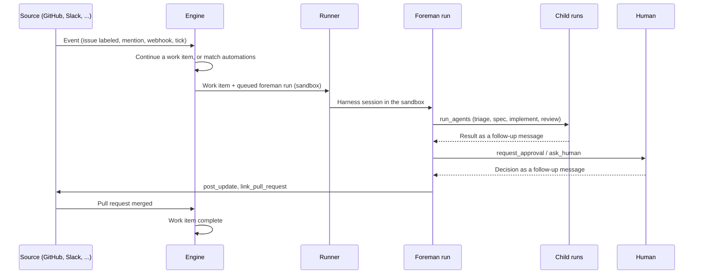

# How factories work

This page follows one request from the first event to the merged pull request, and names the part of the definition that controls each step.

## The path of a request

## 1. Events arrive

Every source becomes the same normalized event: provider, event type, actor, source reference (repository and number, channel and thread, or ticket key), filterable attributes and text.

| Source | Endpoint |
|---|---|
| GitHub, GitLab, Azure DevOps | `/integrations/github/webhook`; GitLab and Azure DevOps are plugins at `/plugins/gitlab/webhook` and `/plugins/azuredevops/webhook` |
| Slack, Microsoft Teams | `/integrations/slack/events`, `/integrations/teams/messages` |
| Linear, Jira | `/integrations/linear/webhook`, `/integrations/jira/webhook` |
| Custom webhooks | `/webhooks/w/{id}` or `/webhooks/w/{id}/{token}` |
| Schedules | The scheduler inside the server (UTC cron) |
| REST API and Factory MCP | `POST /api/v1/factories/{uid}/runs`, the `send_work_item` tool |

The server verifies signatures and tokens before it accepts an event, and ignores a repeated delivery ID.

## 2. The engine routes the event

The engine selects the factories that the event can concern. A factory-scoped source (webhook, schedule, API) names its factory. A forge event concerns the factories that list the repository. A chat or tracker event concerns the factories connected to that integration.

Then it applies these rules in order:

1. **Continue a work item.** If the source (for example `github:acme/api#42` or a Slack thread) belongs to an active work item, the event goes to that work item. A merge or close of a linked pull request updates it. A reply resolves an open approval or question. Other human messages go to the foreman as a follow-up.
2. **Match automations.** Every enabled automation whose trigger matches starts a new work item and a run of its target agent (the foreman by default). Its Markdown body becomes the starting prompt.
3. **Mention of the alias.** If no automation handled a mention of the factory alias, the foreman gets the request.

Bot events do not start work by default, to prevent loops. GitHub triggers control this with `skip_bots`. See [Automations](automations.md).

## 3. A sandbox starts the foreman

The engine creates the work item at stage `intake` and a `queued` run. The run carries a snapshot of the agent's effective configuration: `agentDefaults`, then the agent file, then the automation overrides.

The control plane claims the run and assigns a sandbox. It does not run the agent loop: the runner (`openfactory runner`) does that inside the sandbox and talks to the control plane over HTTP.

1. The control plane selects the worker host: the server's sandbox backend, or the remote worker named by `workerHost`. The backend starts the sandbox (a Kubernetes Job, a local process, a remote worker sandbox or a plugin sandbox).
2. The runner checks out the factory repositories, and runs the machine and environment setup commands.
3. The control plane expands `{{SECRET}}` templates and sets the agent secrets and the `OF_METADATA_*` variables.
4. The skills and the MCP configuration are written for the harness: agent skills, factory skills and the [built-in skills](skills.md#built-in-skills) for the agent type and connected integrations. The harness also loads the skills and rule files that it finds in the repositories.
5. The event that started the run is written to `.openfactory/events/<message_id>/` (see [What the agent gets from the event](automations.md#what-the-agent-gets-from-the-event)).
6. The runner starts the harness with the composed prompt and streams its events to the control plane, which stores them as run messages (the transcript). Artifacts and raw harness transcripts go to [object storage](self-hosting/object-storage.md).

A server replica holds no agent turn, so a replica restart does not interrupt a turn. The runner sends events with a cursor and reconnects to any replica.

The composed prompt is a short platform preamble (role, tools, agents, work item and the rule about untrusted input) followed by the agent instructions. Workflow policy, for example spec approval, lives in the agent instructions. See [Workflow policy](agents.md#workflow-policy).

Every run also gets the `factory` MCP server at `${OF_PUBLIC_URL}/mcp/run/{runId}`, authenticated with the runner's session token. The name `factory` is reserved.

### Artifacts

To keep a file, the agent writes it to `.openfactory/artifacts/` in the workspace (absolute path in `OF_ARTIFACTS_DIR`). A harness can also name workspace files with an `artifact` event (`path` or `paths`).

After each turn, the runner uploads new and changed files to object storage with presigned URLs. Subdirectories stay in the artifact name (`data/out.json`). Symbolic links and files outside the workspace are skipped. A session uploads at most 100 files and 100 MiB; the runner reports a diagnostic that names the files over the limit.

`GET /api/v1/runs/{runId}/artifacts` lists them, each with a short-lived download `url`.

## 4. The foreman orchestrates

The foreman uses the `factory` MCP server to start agents, message other runs, ask people, set the stage, link pull requests and issues, and complete the work item. See [The orchestration server](agents.md#the-orchestration-server).

The default foreman instructions follow triage, spec, approval, implementation, review, handoff. Stages are not agents: the foreman can skip a stage for a small fix, or go back when review finds a problem. `spawnableBy` on an agent controls which agents can start it (default: only the foreman). `OF_MAX_ORCHESTRATION_DEPTH` (default `1`) limits the depth of the run tree, so by default only a root run starts agents.

## 5. Child runs report back

A child run works in its own sandbox. When it finishes a turn, the engine delivers its result to the parent as a follow-up message. If the parent's sandbox still exists, the parent session resumes with the result in context.

A run that finished a turn is `succeeded`, or `blocked` if a request to a person is open (`ask_human`, `request_approval`, or the harness asked for input). Neither state closes the run. A parent that waits for children is also `succeeded`; `active_child_runs` counts the unfinished children.

After the turn, the session stays alive for the idle timeout (see [Follow-ups and idle time](agents.md#follow-ups-and-idle-time)). The runner owns the timer. When it ends, the runner saves a snapshot of the workspace and the harness state, and the session ends.

A message continues the run. If the session is alive, the message goes to it. Otherwise the run goes to `queued` and a new session restores the snapshot: the earlier conversation, the workspace files (including unpushed changes) and the harness state. The run keeps its ID.

## 6. Humans decide

`ask_human` and `request_approval` create inbox items; failures and handoffs do too. People answer in the [dashboard inbox](dashboard.md#inbox), in the source thread (Slack approvals have buttons, and a reply such as "approve" or "reject" resolves an open approval), or on the issue or pull request. The answer to a question or approval goes to the foreman as a follow-up message. Resolving a handoff or a failure closes the item only and does not start the foreman again; to retry after a failure, send a follow-up message.

## 7. The work item completes

The implement agent pushes a branch and opens a pull request. The foreman calls `link_pull_request`, and reviews and review comments on it go to the foreman as messages.

When the last open linked pull request merges, the foreman gets one more turn to post a last message, start follow-up work and call `complete_work_item`. If the work item is still open after that turn, the engine completes it. While other linked pull requests are open, the engine waits. A person can also complete or cancel a work item in the dashboard or the API.

## Definitions change safely

A definition change is a new version. The server compiles and validates the full tree, then applies it atomically. If it is invalid, the server keeps the last valid version and records the errors.

For a `git` source, a push to the production branch starts the synchronization, and pull requests that change definition files get the `openfactory/definition` check. See [Definition reference](definition-reference.md#where-the-definition-lives).
